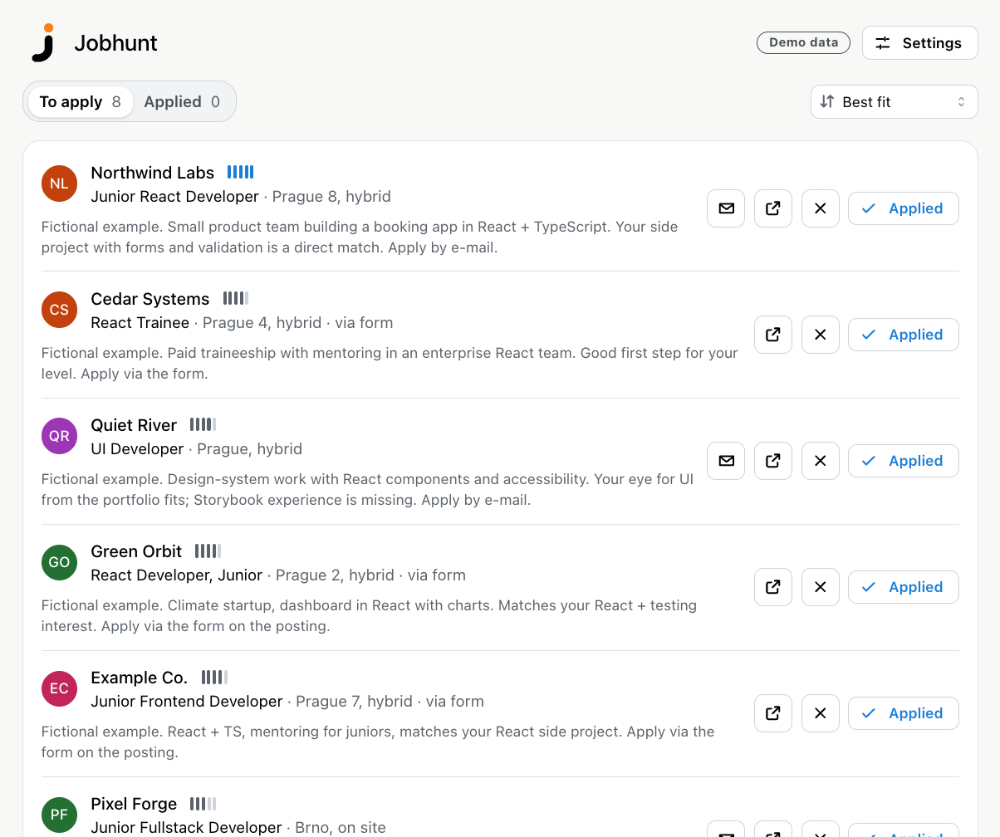

<p align="center">
  
</p>

<h1 align="center">Jobhunt</h1>

<p align="center">
  A job hunt tracker that runs only on your machine. Claude Code finds leads from your CV, you apply.
</p>

<p align="center">
  <a href="https://github.com/rudysides/jobhunt/actions/workflows/ci.yml"></a>
  <a href="LICENSE"></a>
  
</p>

<p align="center">
  <a href="https://claude.com/claude-code"></a>
  <a href="https://pnpm.io"></a>
  <a href="https://react.dev"></a>
  <a href="https://mantine.dev"></a>
  <a href="https://vite.dev"></a>
  <a href="https://www.typescriptlang.org/"></a>
</p>

<br />

## ✨ What is this?

Claude Code reads your CV, searches job boards for positions that fit it, and writes them as leads. The app shows them
as two lists, **To apply** and **Applied**, with a prefilled e-mail and a link to each posting. You apply yourself;
nothing is ever sent for you.

> 🔒 **Local only, not deployable.** It runs on your computer at `127.0.0.1:5180` and nowhere else. Don't host it: a build bakes your
> profile and leads into the bundle. See [Why it isn't deployable](#-why-it-isnt-deployable).

<p align="center">
  <picture>
    <source media="(prefers-color-scheme: dark)" srcset="docs/screenshot-dark.png" />
    <source media="(prefers-color-scheme: light)" srcset="docs/screenshot-light.png" />
    
  </picture>
</p>

## 🚀 Included

- 📄 `/setup`: reads your CV (pdf, md, docx or txt), asks what's missing and writes your search profile
- 🔎 `/find-jobs`: searches job boards and adds matching postings, skipping likely scams
- ⭐ Each job has a fit score from 1 to 5 and notes on why it fits and how to apply
- ✉️ A prefilled e-mail per job, using only addresses printed on the posting
- 📋 Two lists, **To apply** and **Applied**: sort by fit, newest or company, undo a remove, add your own notes
- 💾 Everything stays in your browser and the `profile/` folder, with **Backup** / **Import** to move it
- 🧪 `pnpm demo` to try it with fictional data first

## ⚡ Getting started

You don't need to be a developer. You'll type a few commands into a terminal (Terminal on macOS, PowerShell on
Windows) and Claude Code does the rest.

### What you need

- **Claude Code** with a Claude subscription (Pro or Max) or an API account. `/find-jobs` reads many job pages, so a
  run uses a fair share of your usage; on an API account you pay per run. Install it from
  [claude.com/claude-code](https://claude.com/claude-code).
- **Node.js 24 or newer**, **pnpm** and **Git**:

| System  | Install                                                                                                                                   |
| ------- | ----------------------------------------------------------------------------------------------------------------------------------------- |
| macOS   | `brew install node pnpm git` (with [Homebrew](https://brew.sh)), or Node from [nodejs.org](https://nodejs.org) then `npm install -g pnpm` |
| Windows | `winget install OpenJS.NodeJS Git.Git pnpm.pnpm` in PowerShell, then open a new window                                                    |
| Linux   | Node 24+ from [nodejs.org](https://nodejs.org) or your package manager, then `npm install -g pnpm`; Git from your package manager         |

Check with `node --version` (24 or higher) and `pnpm --version`. Node 25 and newer no longer include Corepack, so pnpm
is always installed separately.

### 1. Download and install

```bash
git clone https://github.com/rudysides/jobhunt.git
cd jobhunt
pnpm install
```

Want to look around first? `pnpm demo` opens the app with fictional data. It never touches your own data.

### 2. Build your profile

Start Claude Code in the folder and run `/setup`, optionally with the path to your CV:

```bash
claude
> /setup ~/Documents/cv.pdf
```

It reads your CV, asks a few questions and writes the `profile/` folder. That folder is yours and never goes into Git.

To change one part later, run `/setup roles`, `location`, `sources`, `filters` or `email`, or describe it: `/setup add
Brno, remote only`. Each row of the profile in **Settings** copies its command for you.

### 3. Find jobs

```bash
> /find-jobs
```

Finds about 15 matching postings. Run it again any time, for example `/find-jobs 30 only remote`. Claude Code asks
before it does anything unusual: read what it asks, and say no if it wants to send your CV somewhere.

### 4. Open the app

In a second terminal window, in the same folder:

```bash
pnpm start
```

Your browser opens [http://127.0.0.1:5180](http://127.0.0.1:5180). Mark jobs as **Applied** once you've sent them,
remove the ones that don't fit. New finds appear on top after a reload.

### Every day

Run `/find-jobs` in Claude Code, reload the app, apply. Make a **Backup** in Settings now and then.

### Updating

```bash
git pull
pnpm install
```

Your `profile/` folder and your progress in the browser stay as they are.

### Moving to another computer, deleting everything

See [docs/data.md](docs/data.md): what is stored where, how to move it, and how to delete it all.

## 🧰 Tech stack

| Layer       | Choice                                               |
| ----------- | ---------------------------------------------------- |
| UI          | React `19` + Mantine `9`                             |
| State       | Zustand `5` over `localStorage`                      |
| Build       | Vite `8`                                             |
| Language    | TypeScript `7`                                       |
| Tests       | Vitest                                               |
| Lint + fmt  | oxlint + oxfmt                                       |
| Lead finder | [Claude Code](https://claude.com/claude-code) skills |

## 📁 Project layout

```text
jobhunt/
├── profile/                   # gitignored, yours (except example/)
│   ├── profile.json           # Roles, locations, remote, sources, exclusions, e-mail template
│   ├── cv.md                  # CV text the agent matches postings against
│   ├── leads.json             # Append-only list of postings found by /find-jobs
│   ├── find-jobs.md           # Optional: your own search rules
│   └── example/               # Committed fictional samples, used by `pnpm demo` and the tests
├── src/                       # The app: reads profile/*.json, state in localStorage
│   ├── i18n/en.ts             # All UI strings
│   ├── validate.ts            # One set of rules for leads, imports and links
│   └── check-leads.ts         # Validates profile/*.json
├── test/                      # Vitest
├── .claude/skills/            # /setup and /find-jobs
└── docs/                      # Data formats, roadmap, security audit
```

## 🧑‍💻 Development scripts

| Command            | Description                                  |
| ------------------ | -------------------------------------------- |
| `pnpm start`       | App on `127.0.0.1:5180`, opens the browser   |
| `pnpm dev`         | Same, without opening the browser            |
| `pnpm demo`        | App with fictional data on `127.0.0.1:5181`  |
| `pnpm check`       | Types, lint, format, `leads:check` and tests |
| `pnpm test`        | Tests only                                   |
| `pnpm leads:check` | Validates `profile/*.json`                   |
| `pnpm fmt`         | Formats everything with oxfmt                |
| `pnpm build`       | Compile check only, writes nothing           |

See [CONTRIBUTING.md](.github/CONTRIBUTING.md) to help out.

## 🛡️ What leaves your machine

- **Nothing from the app.** No backend, no analytics, no external fonts. The dev server binds to `127.0.0.1`.
- **Claude Code** sends your CV text and profile to the Claude model, and makes web searches and page fetches to job
  boards while running `/find-jobs`.
- App state (applied / removed) is in your browser's `localStorage` for `127.0.0.1:5180`. Use **Backup** / **Import**
  to move it.
- **Watch the agent.** Job postings are written by strangers and can contain text aimed at AI agents. The skills treat
  it as data, and the project settings only pre-approve `pnpm leads:check`. Still read what Claude Code asks to do, and
  say no to anything that sends your CV somewhere or opens unexpected sites. The same goes for postings that ask for
  fees, ID scans or bank details: those are scams, and `/find-jobs` skips them.

## 🚫 Why it isn't deployable

It's local-first by design, not a missing feature:

- `profile/*.json` is read **at build time**. A hosted build would publish your CV-derived profile and leads to anyone
  with the URL.
- Leads come from `/find-jobs` writing a local file. There is no server to fetch them from at runtime.
- State lives in `localStorage` for `127.0.0.1:5180`. Any other origin starts empty, and nothing syncs between devices.

`pnpm build` exists only to check that the app compiles. It isn't a deploy step.

## 🎨 Make it yours

| What                                     | Where                                                                |
| ---------------------------------------- | -------------------------------------------------------------------- |
| Search behaviour, sources, `notes` style | `profile/find-jobs.md` (your own rules, `git pull` never touches it) |
| UI text                                  | `src/i18n/en.ts`                                                     |
| Another language                         | Copy `src/i18n/en.ts` and register it in `src/i18n/index.ts`         |
| Example data shape                       | `profile/example/`                                                   |

## 🩹 Troubleshooting

- **"Port 5180 is in use".** The app is already running in another terminal window; use that one or close it. The port
  is fixed on purpose: your browser keeps your progress per address, so another port would show an empty app.
- **The app is empty after switching browser or port.** Your progress lives in the browser you used. Make a **Backup**
  there and **Import** it in the new one.
- **No jobs in the app.** Run `/find-jobs` in Claude Code and reload. `pnpm leads:check` tells you if
  `profile/leads.json` is broken.
- **`pnpm: command not found`.** Install pnpm (see [What you need](#what-you-need)) and open a new terminal window.
- **Something broke.** The app offers **Download raw data** and **Reset app data**. Your jobs come back from
  `profile/leads.json` after a reset; applied marks come back from a backup.
